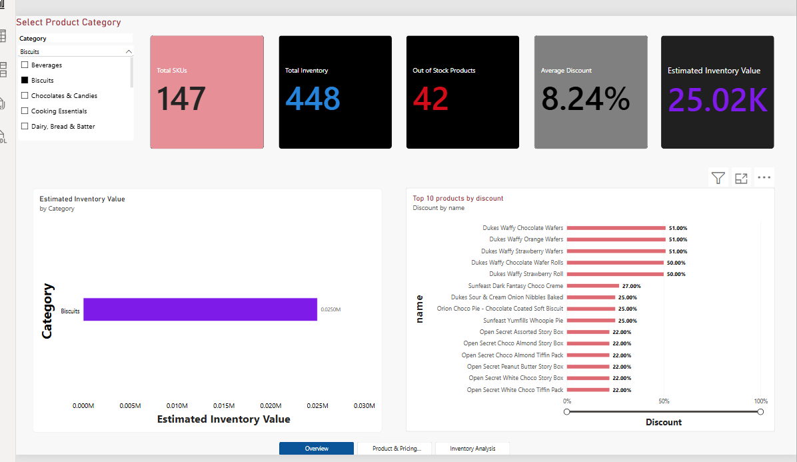
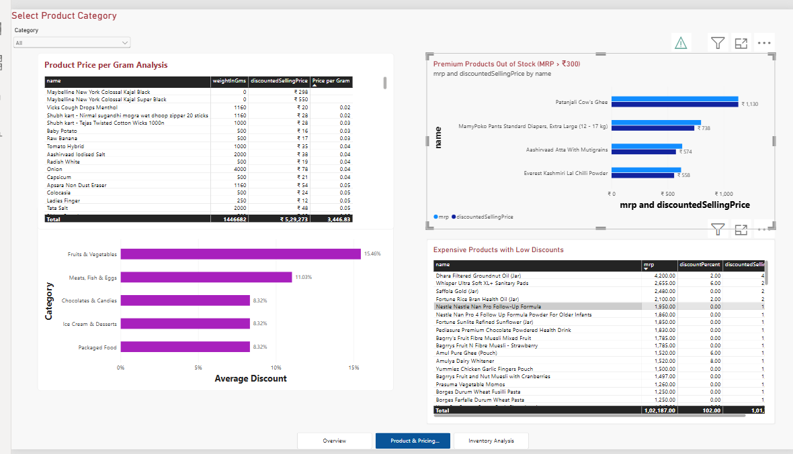
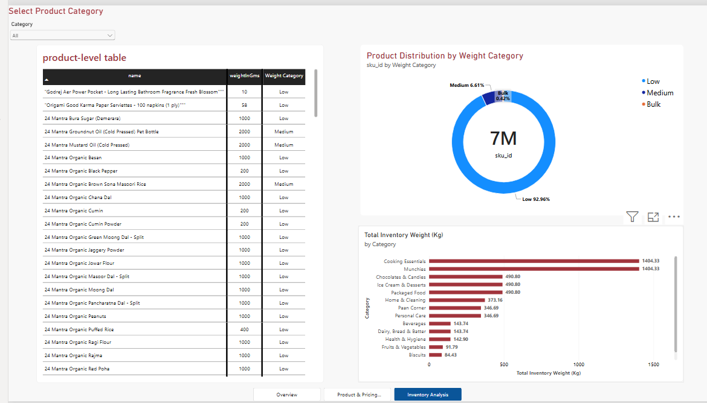

# 📊 Zepto Inventory Dashboard (Power BI)

Interactive 3-page Power BI report built on the cleaned Zepto inventory data (MySQL → CSV → Power BI).

**File:** [`Zepto_Inventory_Analysis_PBI.pbix`](Zepto_Inventory_Analysis_PBI.pbix) (open with Power BI Desktop)

## Screenshots

### Page 1 – Overview


### Page 2 – Product & Pricing


### Page 3 – Inventory Analysis


## Data Cleaning (Power Query)

Renamed columns and set data types:

| Column | Data type |
|---|---|
| sku_id | Whole Number |
| Category | Text |
| name | Text |
| mrp | Decimal Number |
| discountPercent | Decimal Number |
| availableQuantity | Whole Number |
| discountedSellingPrice | Decimal Number |
| weightInGms | Whole Number |
| outOfStock | Whole Number |
| quantity | Whole Number |

Also resolved: missing column-name issues, incorrect data type conversions, errors in the `outOfStock` column, and CSV header problems.

## DAX Measures

```DAX
Total SKUs = COUNTROWS(zepto_cleaned)

Total Inventory = SUM(zepto_cleaned[availableQuantity])

Average Discount =
DIVIDE(AVERAGE(zepto_cleaned[discountPercent]), 100)

Out of Stock =
CALCULATE(COUNTROWS(zepto_cleaned), zepto_cleaned[outOfStock] = 1)

Estimated Inventory Value =
SUMX(
    zepto_cleaned,
    zepto_cleaned[discountedSellingPrice] * zepto_cleaned[availableQuantity]
)
```

## Calculated Columns

```DAX
Price per Gram =
DIVIDE(
    zepto_cleaned[discountedSellingPrice],
    zepto_cleaned[weightInGms],
    BLANK()
)

Weight Category =
SWITCH(
    TRUE(),
    zepto_cleaned[weightInGms] < 1000, "Low",
    zepto_cleaned[weightInGms] < 5000, "Medium",
    "Bulk"
)
```

| Weight | Category |
|---|---|
| Below 1,000 g | Low |
| 1,000 g – 4,999 g | Medium |
| 5,000 g and above | Bulk |

## Report Pages

| Page | Contents |
|---|---|
| **1. Overview** | Total SKUs, Total Inventory, Average Discount, Out of Stock, Estimated Inventory Value, Top 10 products by discount, Estimated inventory value by category |
| **2. Product & Pricing** | Premium products out of stock (MRP > ₹300), Expensive products with low discounts, Top 5 categories by average discount, Price per gram analysis |
| **3. Inventory Analysis** | Product distribution by weight category, Product-level weight category table, Total inventory weight by category |

## 8 Business Questions → Visuals

| # | Business analysis | Visualization |
|---|---|---|
| 1 | Top 10 products by discount | Bar chart |
| 2 | Premium products out of stock | Table |
| 3 | Estimated inventory value by category | Bar chart |
| 4 | Expensive products with low discounts | Table |
| 5 | Top 5 categories by average discount | Column chart |
| 6 | Price per gram analysis | Table |
| 7 | Weight-based product segmentation | Donut chart |
| 8 | Inventory weight by category | Bar chart |

## Interactive Features

- **Category slicer** to filter products by category
- **Slicer synchronization** – same selection applies across all three pages
- **Page navigator** between Overview, Product & Pricing, and Inventory Analysis
- **Data labels** on charts
- **Custom axis range** – discount chart fixed to 0–100% for fair comparison
- **Sorting and Top N filters** for highest-discount products and categories

## Tech Stack

- **MySQL** – data exploration and cleaning
- **Power BI Desktop** – dashboard development
- **Power Query** – data transformation
- **DAX** – measures and calculated columns

## Workflow

MySQL exploration → duplicate detection & removal → CSV export → Power BI import → Power Query transformation → DAX measures → 8 visuals → 3-page report with slicer & navigation.
